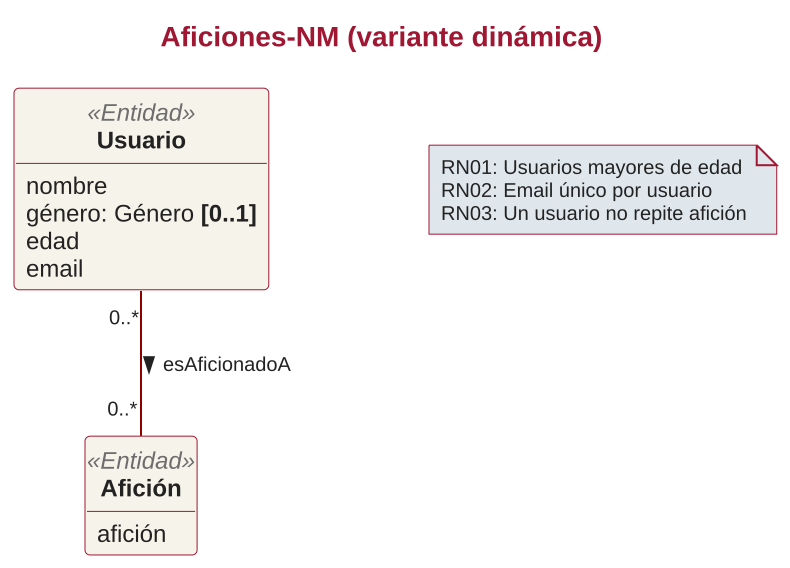
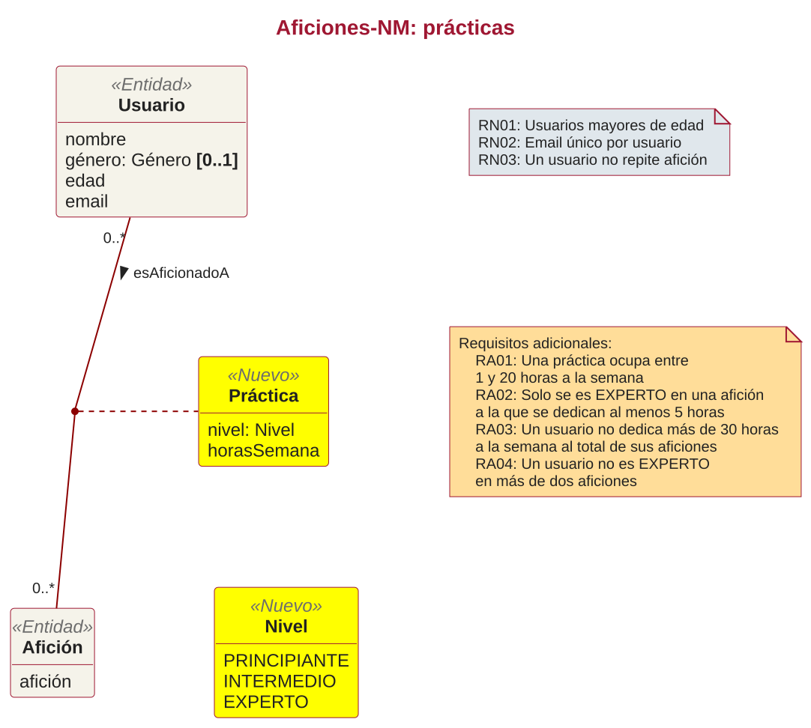

# IISSI-1: Aficiones-NM

Código base del ejercicio [Aficiones-NM](https://iissi-us.github.io/iissi1/ejercicios/req2sql/3_Aficiones-NM/)
de IISSI-1 (requisitos, modelos y solución de la parte base), para resolver «Para trabajar más».

## Cómo empezar

1. Haz un fork de este repositorio en tu cuenta de GitHub y clónalo.
2. Carga la base de datos (`hobbies_nm_db`) desde la carpeta del repositorio:

   ```bash
   mariadb < load_db.sql
   ```

3. Añade tu solución en ficheros nuevos y haz commit y push a tu fork.

| Fichero | Contenido |
|---|---|
| `create_db.sql` | Esquema: `users`, `hobbies` y `users_hobbies` |
| `populate_db.sql` | Datos de ejemplo (`p_populate`) |
| `procedures.sql` | Procedimiento `p_insert_user` |
| `transactions.sql` | Inserción de un usuario con una afición, sin y con transacción |
| `load_db.sql` | Carga los cuatro anteriores |
| `queries.sql` | Consultas RF10–RF16 (`mariadb < queries.sql`) |
| `tests.sql` | Pruebas negativas de RN01–RN03 (`mariadb < tests.sql`) |



# Para trabajar más

## Añadir aficiones desde el catálogo

Implementa una función `f_get_hobby_id` que devuelva el id de una afición a partir
de su nombre, y un procedimiento `p_add_hobby_to_user` que añada una afición a un
usuario existente: si la afición ya está en el catálogo, se reutiliza; si no, se
crea. Si el usuario ya tiene esa afición (RN03), debe lanzar un error. Hazlo en
una transacción.

## Fusionar aficiones

Implementa un procedimiento `p_merge_hobbies` que fusione dos aficiones del
catálogo: los usuarios de la primera pasan a la segunda sin repetirla, y la
primera se borra. Implementa también una función `f_hobby_users` que devuelva
cuántos usuarios tienen una afición y úsala para comprobar el resultado de la
fusión.

## Añadir prácticas

Amplía los modelos para guardar el nivel y las horas semanales que cada usuario
dedica a cada afición, y cumplir las restricciones RA01–RA04 del diagrama.
Actualiza el modelo relacional, el esquema, la carga de datos y las pruebas
negativas.


